<a href="https://manojkj-portfolio.vercel.app"></a>

  <a href="#origin">Origin</a> ·
  <a href="#arsenal">Arsenal</a> ·
  <a href="#stack">Stack</a> ·
  <a href="#dimensions">Dimensions</a> ·
  <a href="#route">Route</a> ·
  <a href="#headlines">Headlines</a> ·
  <a href="#signal">Signal</a> ·
  <a href="#next-issue">Next issue</a>


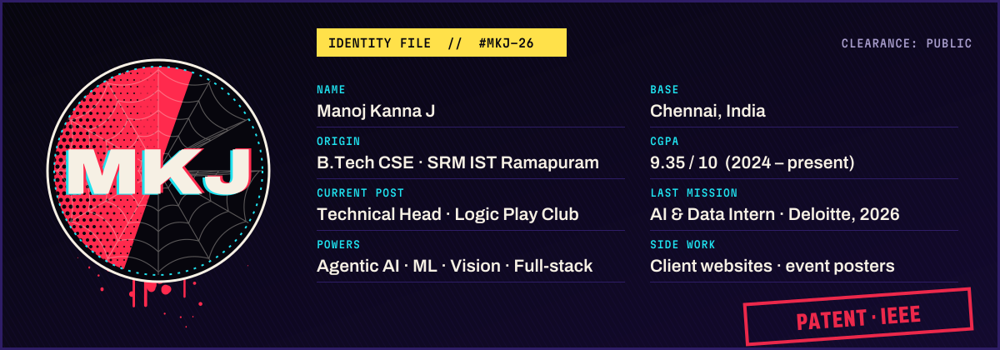

I'm a B.Tech Computer Science student at SRM IST Ramapuram, Chennai (CGPA 9.35). I build agentic AI systems, machine-learning models and the full-stack apps around them.

From June to August 2026 I was an AI & Data Intern at **Deloitte** (Technology & Transformation). I built agentic AI workflows with CrewAI and LangGraph, worked on RAG for a private, in-house VS Code coding assistant, monitored agents with LangFuse and deployed on AWS with Docker. My latest project is a two-stage ML guard for LLM agents: it flags instructions planted in tool outputs and predicts whether the agent would obey them.

With SurgeGuard, a real-time crowd and queue prediction system, my team of three won **Best Implementation at SENSORA 2.0**. My **IEEE-published** DOP-XML research was presented at ACM IKDD events at IISER Pune and IIIT Bangalore, and I've patented an ML-based application. I'm Technical Head of the Logic Play Technical Club, and I also build client websites and design event posters.


Solid chips are used in my projects. Half-filled chips I applied at my Deloitte internship or in club workshops. Dashed ones complete the skill set on my resume.


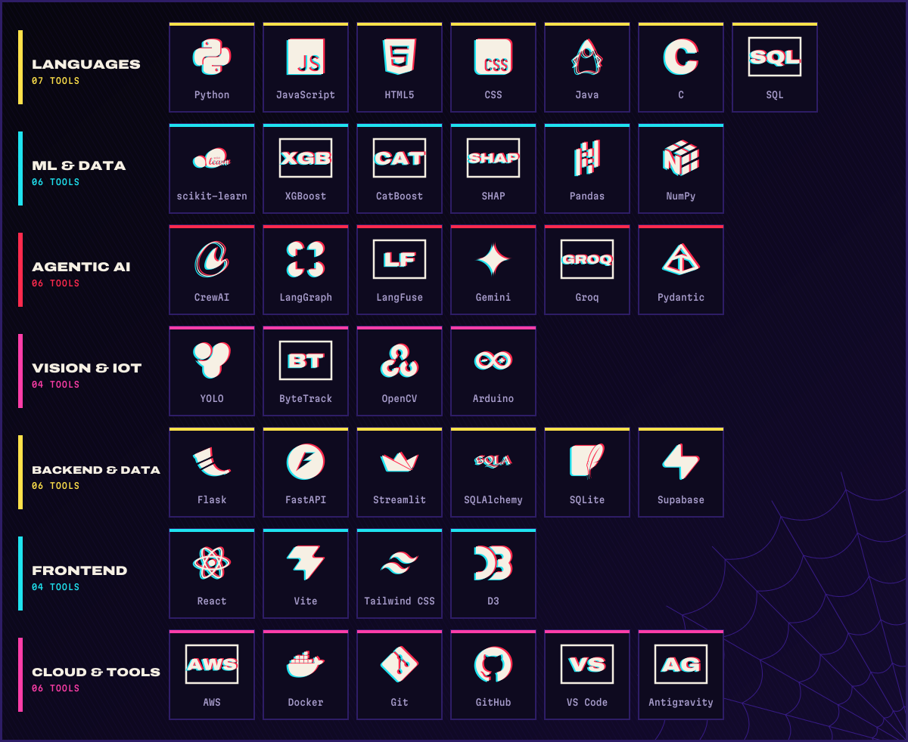

Logos from <a href="https://simpleicons.org">Simple Icons</a> (CC0); each belongs to its owner. Tools without an icon there are shown as lettered badges.


<a href="https://github.com/HavenLeno22/surgeguard-crowd-safety">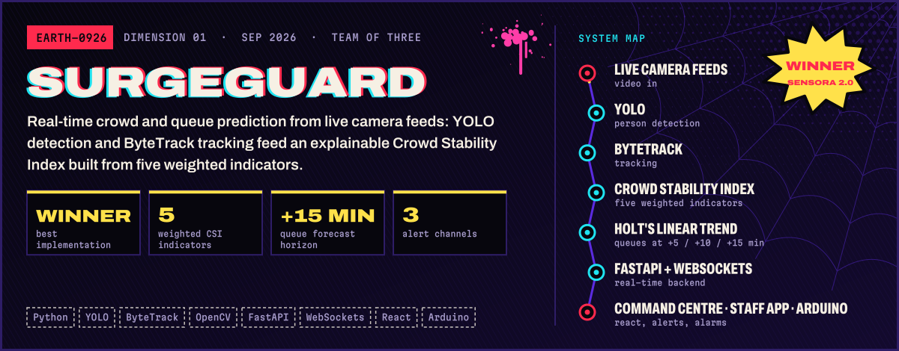</a>

<a href="https://github.com/manojkannaj8/prompt-injection">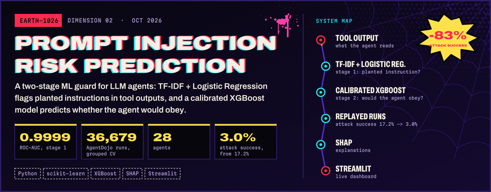</a>

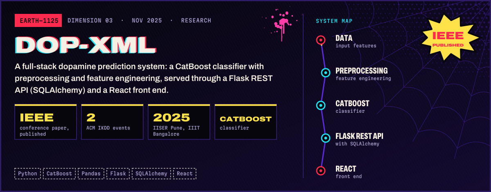

<a href="https://github.com/manojkannaj8/Multi-Agentic-Resume-Analyser">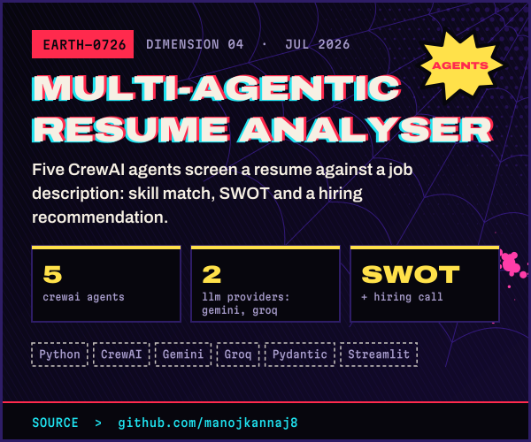</a>
<a href="https://repo-lens-nu.vercel.app">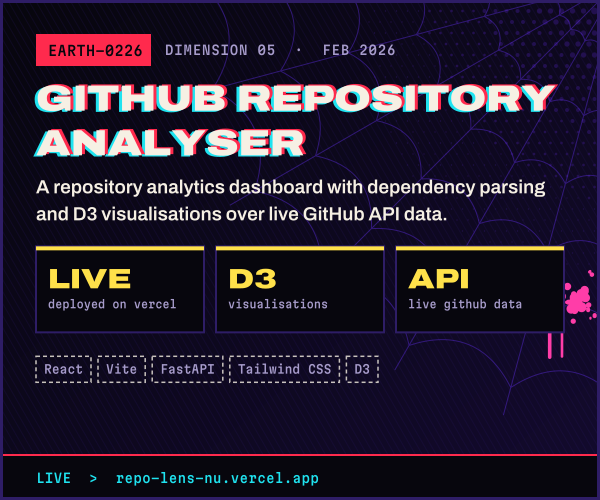</a>

<b>More from the multiverse</b>

 

| Build | What it is | Stack |
|---|---|---|
| [GridNavigator](https://github.com/manojkannaj8/Grid-navigator) | BFS pathfinding visualiser: draw walls, watch the queue step by step, then walk a Three.js 3D maze | JavaScript, Three.js |
| [Neural network loss landscapes](https://github.com/SanjaySakamuri/neural-network-loss-landscapes) | Contributor to a comparative study of how SGD, RMSProp and Adam travel a loss surface | Python |
| AgriGuard *(private)* | Desktop app that estimates crop-disease risk from live weather, with MobileNetV2 image checks and spoken alerts | Python, TensorFlow, Tkinter |
| [Logic Play club site](https://logic-play-club.vercel.app) | The club website I co-maintain as Technical Head | Web |
| [User authentication portal](https://github.com/manojkannaj8/User-Authentication-portal) | An early front-end sign-in flow | HTML, CSS, JavaScript |


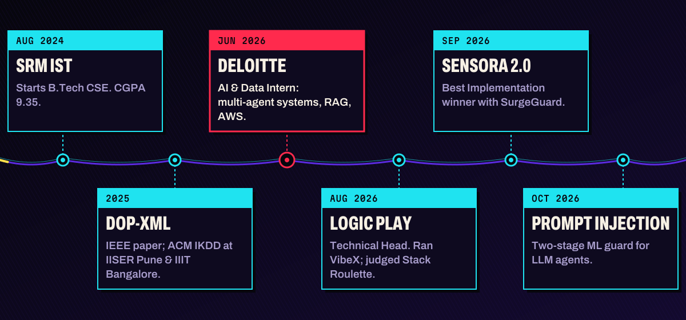

<table>
<tr>
<td width="50%" valign="top">

**AI & Data Intern · Deloitte**  Technology & Transformation · Jun – Aug 2026

- Built agentic AI workflows with CrewAI and LangGraph, implementing multi-agent systems with tool calling
- Developed Flask backends with React and Streamlit frontends, debugging issues and improving code quality
- Worked on RAG for a private, in-house VS Code coding assistant, taking Continue.dev as inspiration
- Monitored agents with LangFuse (latency, tokens, traces); deployed on AWS EC2, S3 and Lambda with Docker

</td>
<td width="50%" valign="top">

**Technical Head · Logic Play Technical Club**  Aug 2026 – present

- Conducted **VibeX**, a hands-on web development workshop on React, Supabase, prompt engineering, GitHub and Vercel; guided participants and debugged their apps in the follow-up challenge
- Judged **Stack Roulette**: teams drew a random tech stack, picked a problem statement and built an app with it
- Co-maintain the club website, [logic-play-club.vercel.app](https://logic-play-club.vercel.app), and oversee technical initiatives

</td>
</tr>
</table>


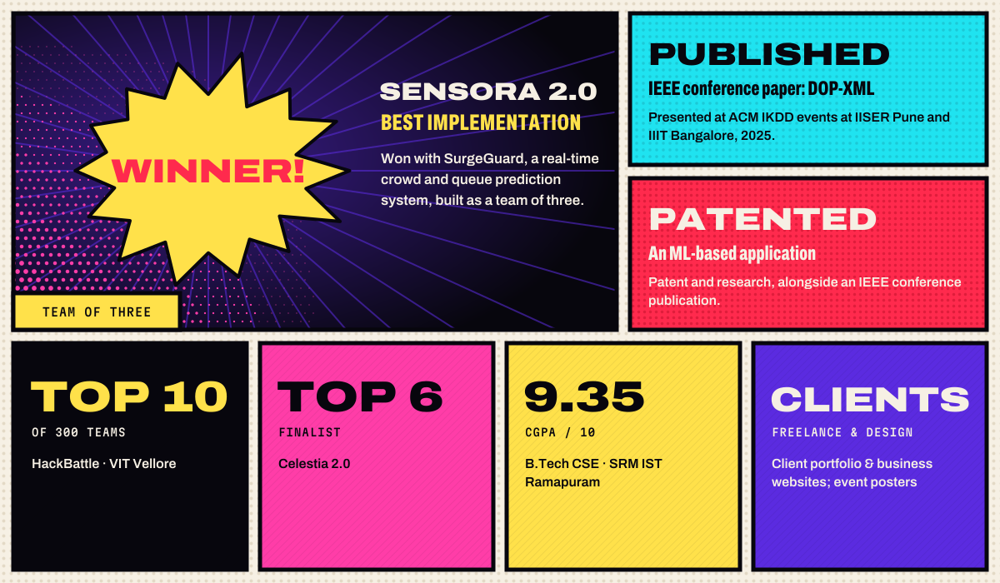


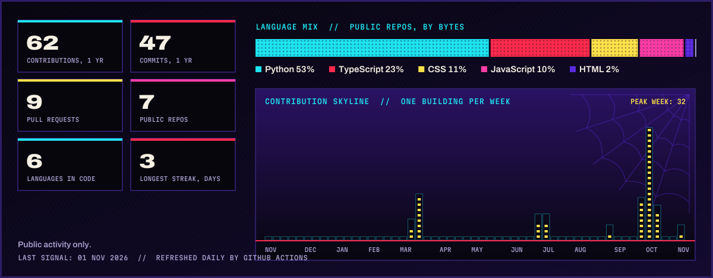


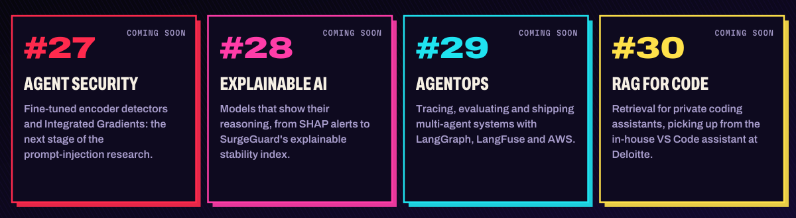

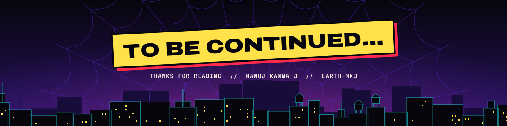

  
  
  

Every graphic on this page is hand-built SVG, generated by the scripts in <a href="scripts">/scripts</a>. Type: Archivo & Martian Mono (SIL OFL).

